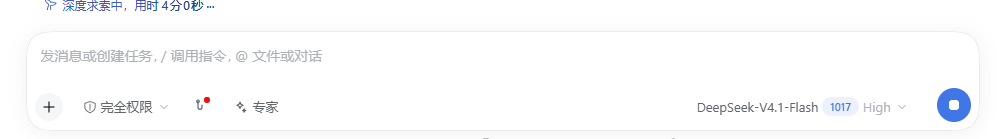
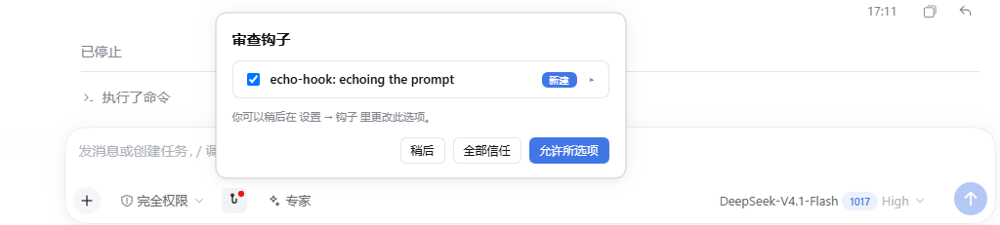
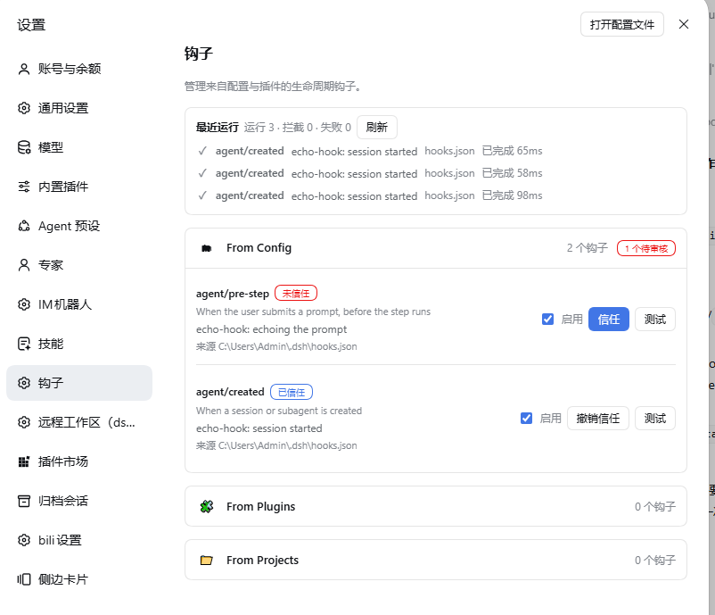
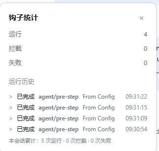

# dsh-codex-hooks

**Codex's hook management, ported to [DeepSeek Harness](https://github.com/deepseek-ai/deepseek-harness) (dsh).**

Codex gives every hook a review step, a fingerprint you approve once, a settings page, a `/hooks` browser and a stats panel. dsh ships none of that: it exposes interception seams and nothing around them. This plugin ports that management layer over, so hooks on dsh are reviewed, trusted, switched off and inspected the same way they are in Codex.

The config file is dsh's own (`hooks.json` with dsh event names) — what is ported is the behaviour around it, not Codex's file format.

中文文档：[README.zh.md](README.zh.md)

## Screenshots

Review happens where the work happens — a hook button in the composer, a red dot while something is unapproved:



Clicking it opens the review dialog: one row per hook, a *New* badge, a chevron for the details, and *Not now / Allow all / Allow selected*:



Everything else is managed in **Settings → Hooks**: hooks grouped by where they came from, each with its trust state, an on/off switch, *Trust* / *Revoke* and a dry-run *Test*:



Per-run detail lives behind the message action row. The **Hook stats** dialog reads one turn, names it, and lists that turn's runs with the session totals underneath — no turn picker, it answers for the message you opened it from. Turns are numbered from the agent's counter, which starts over when the host restarts, so a turn that cannot be found by number is matched by how far back from the newest turn it sits; a turn further back than the log goes answers with `0` rather than borrowing another turn's numbers:



The screenshots come from a local dsh install running the two `echo-hook` entries in `~/.dsh/hooks.json` — the same config the examples in this repo use.

## Compatibility

| Plugin | Verified against |
| --- | --- |
| 0.5.x | dsh `0.1.0-rc.6` (development and self-test host, web + desktop) |

Newer dsh releases are untested: the plugin reads dsh's slot, command and remote-method contracts, and a host that renames one of those breaks it until it is updated.

The client half binds to four dsh client packages — `@deepseek-ai/dsh-client-locale`, `@deepseek-ai/dsh-client-ui-settings`, `@deepseek-ai/dsh-client-ui-commands` and `@deepseek-ai/dsh-client-ui-chat`. The first three ship with the profile; `dsh-client-ui-chat` is what provides the `conversation.chat.turnTail` slot the "open the stats of the message you clicked" feature needs, and on some installs it only exists inside the app's own `node_modules`. If the message-level hook button shows no turn, that package was the missing piece.

## What it actually does

- **Discovers** `hooks.json` from three places, grouped in the UI:
  - **From Config** — `$DSH_HOME/hooks.json` (default `~/.dsh/hooks.json`).
  - **From Plugins** — every package inside the active profile that ships a `hooks.json`.
  - **From Projects** — `<workspace>/.dsh/hooks.json` for the workspaces this session has touched (up to 32 remembered).
- **Fingerprints** each hook: normalized JSON of the hook definition, `sha256:` over its UTF-8 bytes. The fingerprint is what the trust decision is pinned to, so editing a hook's command invalidates its trust instead of silently running new code.
- **Reviews trust per hook** in the settings page: new hooks start in *needs review*; you approve the current fingerprint, and the state lives in `$DSH_HOME/hooks.state.json` together with an independent enabled/disabled switch per hook.
- **Runs** `command` handlers only when they are enabled *and* trusted, with the hook's own timeout, `cwd`, environment and `command`/`commandWindows` split. An `approval/request` hook may answer `{"decision":"allow"}` to auto-approve the pending tool call, or `deny`; a deny from any hook wins over an allow.
- **Injects context**: a handler's `additionalContext` is appended to the model input on `agent/pre-step`, `tools/pre-execute`, `tools/post-execute` and `agent/created` (2500 characters by default).
- **Matches** the tool seams (`tools/pre-execute`, `tools/post-execute`, `approval/request`) with `*`, exact names, `Name|Other` or a regular expression.

### Events

| Event | Fires | Can block |
| --- | --- | --- |
| `agent/pre-step` | a prompt was submitted, before the step runs | yes |
| `agent/request` | before the model request is sent | no |
| `tools/pre-execute` | before a tool call runs | yes |
| `tools/post-execute` | after a tool call finished | yes |
| `approval/request` | before a tool call asks for permission | yes |
| `agent/created` | a session starts | no |
| `agent/turn-stopping` | right before the turn ends | no |
| `session/disposed` | the session is disposed | no |

Default timeout is 600s, except `session/disposed` (1s default, 3s maximum) so shutdown cannot hang.

## Review, run history and `/hooks`

- **Hook button in the composer** — a hook icon sits in the composer's tool row (next to the permission and agent controls), with a small red dot while hooks still need review (no number — a count goes stale as soon as a hook is trusted elsewhere); clicking it opens the **Review hooks** dialog: one row per hook with a checkbox, the hook name, a *New* badge and a chevron that expands *Source / Hook type / Command / Timeout*, then the hint "You can change this later in Settings, under Hooks" (plain text: dsh exposes no API for a plugin to open a settings section, so it does not pretend to jump) and the three choices *Not now / Allow all / Allow selected*. Approving pins the current fingerprints in `$DSH_HOME/hooks.state.json`; everything else is handled later in **Settings → Hooks**, one hook at a time.
- **`/hooks` opens the hooks browser** — the first page lists the events with `active/installed` and a `!` marker on the events that need review, the second page lists the handlers of one event with their trust state, an on/off switch and a *Trust* / *Revoke* button. It is a normal dsh slash command (registered when the host composes the `commands` service), so it never reaches the model.
- **Hook stats in the message action row** — the assistant message action row carries a hook icon; clicking it opens a **Hook stats** dialog. Like Codex, every run belongs to the turn that triggered it, so the dialog reads **one turn at a time** (`Runs / Blocked / Failed`, plus `Running` while a slow hook works) and names that turn, with the session totals underneath. There is no turn picker: the dialog answers for the message you opened it from. The *Run history* list shows that turn's executions (`Completed  agent/pre-step  User`); the dialog refreshes every 1.5s while it is open. Hook output is *not* printed into the conversation; the model only ever sees a handler's `additionalContext`. The run log lives in memory for the session and is not written to disk — a reload starts empty, exactly like Codex, whose `HookStarted`/`HookCompleted` notifications are transient too. `/hooks` keeps the session-wide view. Clicking a message opens **that message's turn**, not whatever turn is current: a companion renderer on `conversation.chat.turnTail` — which does receive the whole `TurnLocation`, and renders before the action row of the same turn — records which turn each message ends, and the dialog opens on it, falling back to the current turn for a message it has never seen. One deliberate difference from Codex: `agent/pre-step` fires before **every step** of the agent loop (`{ turn, step }`), not once per submitted prompt, so an `agent/pre-step` hook runs once per model call inside a turn — that is why a single turn can show several runs.
- **Dry run** — *Test* in the settings page runs one hook once with sample input and reports ok / blocked / failed plus the duration. It refuses to run a hook that has not been approved.
- **Floating panels** — every panel is rendered through a portal on `document.body` with a fixed position, so it is never clipped by the composer or the message column.

### Auto-approving a tool call

An `approval/request` hook can decide the pending approval itself:

```json
{
  "hooks": {
    "approval/request": [{ "command": "node examples/approval-allow.mjs", "timeout": 10 }]
  }
}
```

The hook prints `{"decision":"allow"}` to approve that one call, `{"decision":"deny","reason":"…"}`
to refuse it, or nothing at all to let the normal prompt ask. A deny from any hook wins over an
allow from another. `examples/approval-allow.mjs` only allows the tool named in
`APPROVAL_ALLOW_TOOL`, because a hook that approves everything silently removes the prompt.

## Install

Requires dsh `0.1.0-rc.6` or newer and Node 20+.

```bash
# from GitHub
dsh plugin --profile desktop add github:matata2017/dsh-codex-hooks

# or from a local checkout, which is how this project is developed
dsh plugin --profile desktop add /path/to/dsh-codex-hooks
```

Restart the dsh web/desktop host afterwards, then open **Settings → Hooks**.

## Configure

`~/.dsh/hooks.json`:

```json
{
  "version": 1,
  "description": "my hooks",
  "hooks": {
    "agent/created": [
      {
        "command": "node ./examples/echo-hook.mjs agent/created",
        "commandWindows": "node.exe ./examples/echo-hook.mjs agent/created",
        "timeout": 15,
        "statusMessage": "echo-hook: session started"
      }
    ],
    "tools/pre-execute": [
      {
        "matcher": "Bash",
        "command": "node ./examples/echo-hook.mjs"
      }
    ]
  }
}
```

One object per hook: `command` (or `type: "mcp_tool"` with `server` + `tool`), optional `matcher`, `timeout`, `statusMessage`, `additionalContextLimit`, `async`.

Handler types: `command` is the only one executed. `mcp_tool`, `prompt` and `agent` are parsed and reviewable but not dispatched — they show up as installed, never as active, because a hook that silently does nothing is worse than one that says so.

## Verification status

- `node test/run-tests.mjs` → **98 passed, 0 failed, 0 skipped**.
- `node selftest/host-e2e.mjs` → **20 passed, 0 failed** against a real profile.
- `agent/pre-step` runs in a live dsh session once the hook is trusted: the example hook prints one `echo-hook received event=…` line per agent step (it fires before every step, so one prompt can produce several lines). A hook stays untrusted until you approve it in the review dialog or in Settings → Hooks; an untrusted hook never runs.

## What a hook cannot do here

These are dsh boundaries, not missing code: they need a seam the harness does not expose. Codex has these; dsh does not, so the port stops here.

- **Context is user-role only.** `agent/pre-step` takes `UserMessage[]`, and no public API appends a developer message, so `additionalContext` cannot arrive with the extra weight a developer message would carry.
- **Tool arguments cannot be rewritten.** `tools/pre-execute` returns allow / deny / ask / cancel; dsh deliberately excludes input rewriting because arguments are already logged and presented.
- **No seam for compaction, interrupt, or model-request events.** `agent/created` with `source: "compact"` is the closest thing to a post-compaction hook.
- **`mcp_tool`, `prompt`, `agent` handlers are reviewable but not executed**, so they never show as active.

## Security

Hooks execute real commands with the permissions of the dsh process. That is why trust is pinned to the sha256 fingerprint of each hook: approving a hook approves exactly that command line, and any edit requires a new approval. Only enable hooks you have read.

## License

MIT

### Client bundles share one global scope

The browser loader concatenates every installed plugin client bundle into a single script, so a top-level `const` is visible to all plugins. Two plugins that pick the same name is a `SyntaxError` that stops the whole app from booting, not just one plugin. This client bundle therefore runs inside its own function and declares nothing globally.
